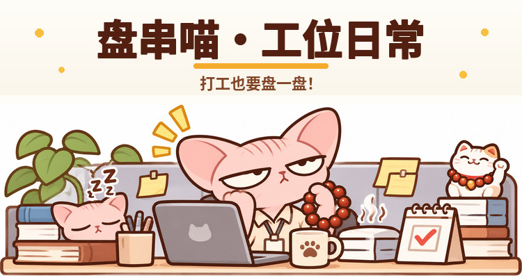
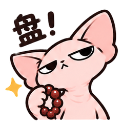
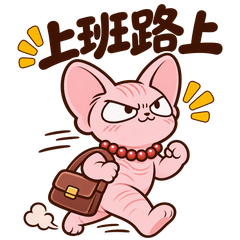
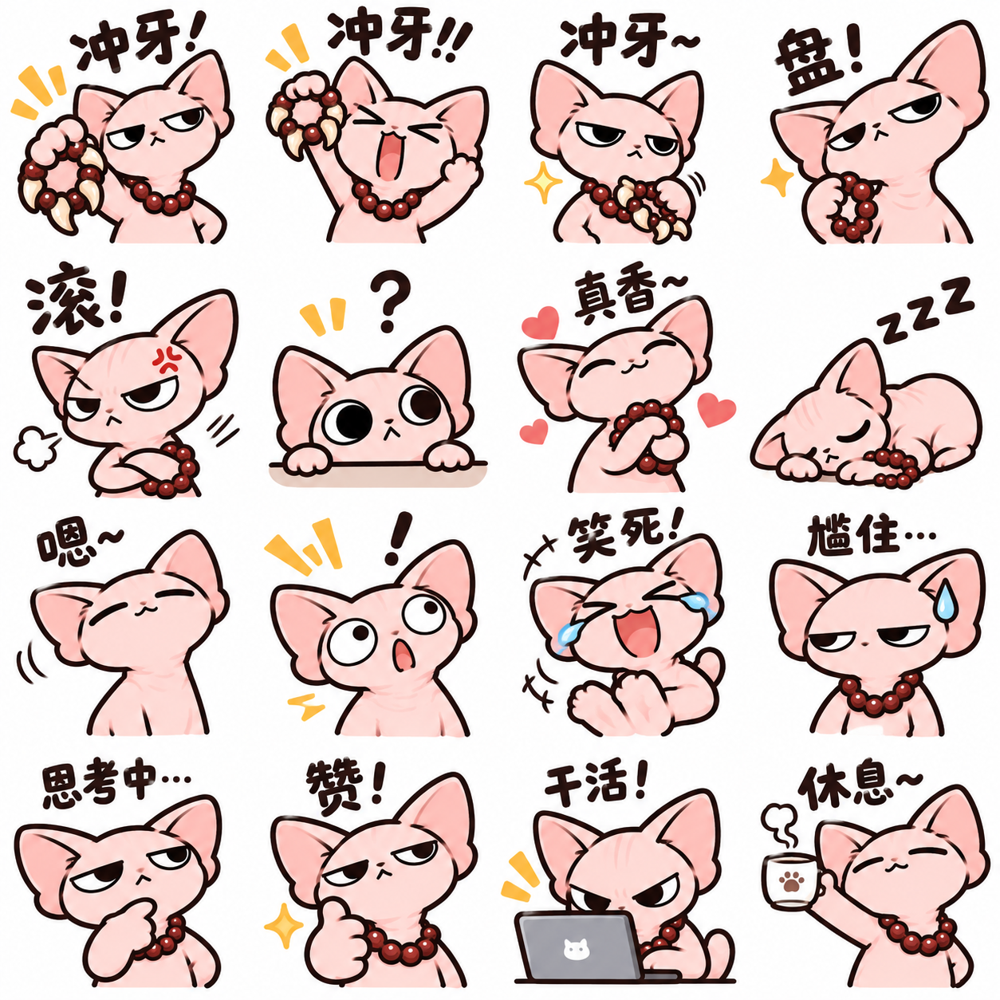
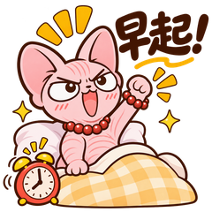
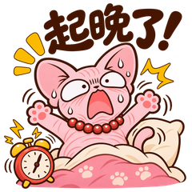
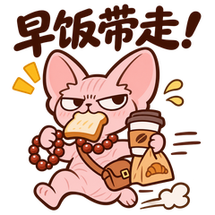
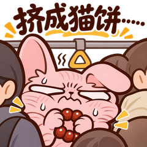
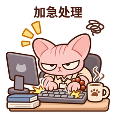

# 🐱 盘串猫 · EmojiWeChat

> **早起赶地铁，工位盘手串。打工可以累，手串不能停！**

**盘串猫（也叫「盘串喵」）**是一只爱盘手串的粉色无毛猫。它有夸张的大耳朵、半眯的拽拽眼神和红棕色手串，主打可爱、欠欠的幽默感。本仓库用于归档角色设定、微信表情包设计稿、独立 PNG 素材及专辑配图。



## ✨ 表情包系列

| 系列 | 示例 | 内容与入口 |
| :--- | :---: | :--- |
| **盘串猫 · 基础表情** |  | 16 张 V2 参考画风表情，包含「冲牙」「盘起来」「真香」「睡觉」等。**[浏览素材](盘串猫/stickers/v2_reference_style/)** |
| **盘串喵打工喵 · 上班路上** |  | 16 张独立静态表情，从赖床、洗漱、赶车到抵达工位。**[浏览素材](盘串喵打工喵/)** |
| **工位喵 · 办公室日常** |  | 包含开工、摸鱼、加班、赶工、午休等多个批次的表情设计与专辑素材。**[浏览素材](工位喵/)** |

## 🎨 角色设定

- **主角**：粉色无毛猫，圆脑袋、超大耳朵、简洁的面部褶纹。
- **标志性表情**：半眯眼、斜眼、撇嘴；偶尔震惊、抓狂、满足。
- **标志道具**：红棕色手串（以小叶紫檀手串为原型），有时加入文玩核桃等情节道具。
- **画风**：深棕色粗描边、柔和粉色系、夸张动作、简短醒目的中文文案。
- **设计原则**：同一系列尽量保持猫脸、耳朵比例和手串造型一致；优先让表情与动作清楚易读，避免道具过度堆叠。

完整角色基准、设计决策和制作约定请看 **[盘串猫角色设定文档](盘串猫/README.md)**。

## 📁 仓库结构

```text
emojiwechat/
├── README.md
├── 盘串猫/
│   ├── README.md                 # 角色设定与设计记录
│   ├── concepts/                 # 概念资料
│   ├── animations/               # 动态表情规划资料
│   └── stickers/
│       └── v2_reference_style/
│           ├── 120/              # 16张缩略图
│           ├── 240/              # 16张微信尺寸参考 PNG
│           ├── 512/              # 高清备份与扩展素材
│           └── preview/          # 总览、透明度检查图
├── 盘串喵打工喵/
│   ├── 01_早起.png ~ 16_挤成猫饼.png  # 16张晨起通勤表情
│   ├── 横幅/                    # 横幅、专辑封面、聊天图标
│   └── README.md
└── 工位喵/
    ├── 01_/                    # 第一批设计图及专辑配图
    ├── 02_/                    # 第二批独立表情及设计图
    ├── ss/                     # 工位系列其他表情素材
    └── readme.md
```

> 不同子目录中同时保存了 **高清原图、设计稿和适配微信尺寸的图片**。它们的分辨率、文件大小和透明度可能不同；请勿把所有 PNG 都直接当作已通过审核的投稿成品。

## 🖼️ 素材预览

### 基础表情



### 上班路上

| 早起 | 起晚了 | 早饭带走 | 挤成猫饼 |
| :---: | :---: | :---: | :---: |
|  |  |  |  |

### 工位日常

| 偷偷盘串 | 午休勿扰 | 灵魂出窍 | 加急处理 |
| :---: | :---: | :---: | :---: |
|  |  |  |  |

## 📥 下载和使用

1. **浏览单张**：点击上面的系列链接，进入对应文件夹，打开所需 PNG。
2. **下载单张**：在 GitHub 文件预览页点击下载按钮。
3. **下载整库**：在仓库首页点击 **Code → Download ZIP**。
4. **制作微信表情专辑**：从对应系列选取独立图片，逐张核对尺寸、文件体积、透明背景、文字和表情动作，并准备封面、图标与横幅。

制作参考：部分静态表情已导出为 **240 × 240 PNG**；部分专辑封面为 **240 × 240 PNG**，聊天图标为 **50 × 50 PNG**。这只是仓库内已有的素材规格，**正式投稿时须以 [微信表情开放平台](https://sticker.weixin.qq.com/) 当时展示的要求为准**。

## 🔍 投稿前检查清单

- [ ] 选择同一画风的独立表情，避免混入概念拼图或不同风格原图
- [ ] 确认画面尺寸、格式、大小满足平台限制
- [ ] 检查透明通道、边缘白边与缩小后的清晰度
- [ ] 检查中文文案、错别字、位置和可读性
- [ ] 检查封面、横幅和图标与本套表情一致
- [ ] 按平台要求完成投稿及审核流程

## 📌 项目说明

本项目主要用于**盘串猫角色与表情素材的持续创作、整理、备份和迭代**，部分图稿采用 AI 辅助创作。仓库展示不代表微信官方认证或审核通过。

**使用授权**：仓库目前没有明确声明开放许可。公开可见不等于自动允许商用、转载或二次分发；如需此类使用，请先联系仓库维护者。

---

**盘串喵的工位哲学：工作归工作，盘串归盘串。** 🐾
