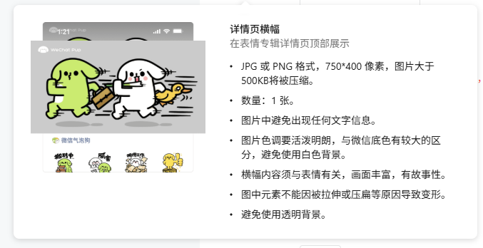
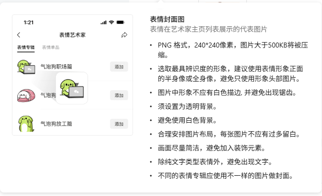
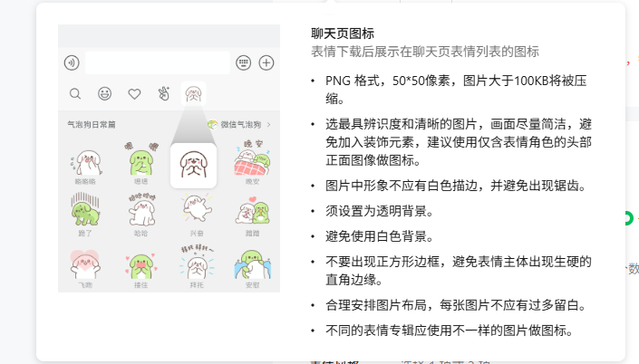

# 微信表情专辑图片设计标准｜详情页横幅、表情封面图、聊天页图标

> 版本：**v1.0**  
> 规范整理日期：**2026-11-19**（这是本文件整理日期，不代表截图所示页面的发布日期）  
> 来源：用户提供的**微信表情开放平台界面截图**，与现有仓库规范联合整理。  
> 适用范围：`emojiwechat` 所有角色和系列，包括盘串猫、工位喵、手把件、圣诞节、小猪咪等。  
> 若微信投稿页面日后更新，以**投稿时的实际页面**为准，再同步维护本文件。

## 1. 平台截图原始依据

本规范保留了三张**未经重新绘制、未更改内容的用户截图**，便于追溯每一条尺寸和视觉要求。

### 1.1 详情页横幅

### 1.2 表情封面图

### 1.3 聊天页图标

## 2. 三项素材的规格总表

| 素材 | 用途 | 格式 | 精确尺寸 | 数量 | 截图提示的压缩阈值 | 背景 |
|---|---|---|---:|---:|---|---|
| **详情页横幅** | 表情专辑详情页面顶部 | **JPG / PNG** | **750 × 400 px** | **1张** | **大于500 KB平台将压缩** | **不透明**；亮色、区别于微信底色 |
| **表情封面图** | 表情在艺术家主页列表中的代表图 | **PNG** | **240 × 240 px** | 通常每专辑一张 | **大于500 KB平台将压缩** | **真正透明**；不能用白底代替 |
| **聊天页图标** | 聊天页表情列表的缩略识别图标 | **PNG** | **50 × 50 px** | 通常每专辑一张 | **大于100 KB平台将压缩** | **真正透明**；不能用白底代替 |

**重要解释：** 截图的原意是“图片大于500KB/100KB将被压缩”，**不是**“超出即被拒绝”或“一律不能上传”。本仓库可采用更严格的**内部交付目标**：横幅优选≤80 KiB、封面≤80 KiB、图标≤30 KiB（优选≤15 KiB），以降低平台二次压缩风险。内部目标与微信截图中的压缩阈值不得混写。KB/文件大小口径按上传界面优先，不以本仓库的 KiB 检验代替平台判断。

## 3. 详情页横幅｜750 × 400

来自截图的**要求**：

1. **JPG 或 PNG**，准确导出 **750 × 400**，每个专辑**1张**。
2. **画面中避免出现任何文字信息**：不放专辑标题、广告语、作者名、网址、二维码等；即使做 GitHub 宣传图，也要**另存无字投稿版本**。
3. **色调明亮、活泼**，与微信底色形成较明显区分；避免大面积纯白、灰白背景。
4. **内容必须与表情相关**：使用本专辑的同一角色、同一画风、关键动作或主题道具。
5. **画面丰富、表达有效**，但不能堆砌或造成主题不清。
6. **任何图形元素均不能被拉伸或压扁而变形**：裁切、重排、等比缩放可以，拉宽/压缩猫脸不可以。
7. **不可使用透明背景**，整个 750 × 400 画布必须不透明。
8. 超过 **500 KB** 的图片，截图提示平台**会压缩**。

**项目建议**（不属于截图中的强制数值）：浅奶油、浅桃色、浅暖色背景；角色在横幅中占主视觉，四边留足安全空间；避免高频噪点和需要读字才能理解的构图。

## 4. 表情封面图｜240 × 240

来自截图的**要求**：

1. **PNG**，准确导出 **240 × 240**；超过 **500 KB** 将被压缩。
2. 选取**最具辨识度的形象**，推荐**正面半身像或全身像**。
3. **避免只使用形象头部图片**，也应避免把**多个形象**塞进同一封面；封面重点是一个代表性主体。
4. 主体**不应有白色描边**，并避免锯齿、毛边。
5. **必须是真透明背景**，不能用白色背景或伪透明棋盘格代替。
6. 合理安排构图：不要过多留白，不可使主体过小；同时完整展示关键轮廓。
7. 画面尽量**简洁**，避免额外装饰元素。
8. **除纯文字类表情外，不出现文字**。
9. 不同的表情专辑应使用**不一样的封面图片**，不能原样复用。

**项目建议**：保留盘串喵的大耳朵、粉色无毛皮肤和深棕粗描边；若有主题道具（核桃/葫芦/圣诞礼物/电脑等），只使用一个最具代表性的道具。封面不直接使用复杂的 16 宫格拼图，也不在四角铺背景颜色。

## 5. 聊天页图标｜50 × 50

来自截图的**要求**：

1. **PNG**，准确导出 **50 × 50**；超过 **100 KB** 将被压缩。
2. 选取**最具辨识度且清晰**的图像，**画面尽量简洁**，推荐**只有角色头部的正面图像**。
3. **不能有白色描边**，避免锯齿、白边。
4. **必须是真透明背景**；不能以纯白背景替代。
5. **不得出现正方形边框**，尤其避免主体直接出现**生硬的直角边缘**。
6. 合理安排构图，不得留太多空白。
7. 不同表情专辑**图标不能使用同一张图片**。

**项目建议**：50px 的图标必须**单独重排**，仅保留大耳朵、猫脸、眼神和极少量主题特征；不要将带背景、带标题的横幅或复杂封面直接缩小。通常不加文字，避免 50px 下不可读。

> **封面和聊天图标的构图要求不一样**：封面推荐正面半身/全身且避免仅头部；**聊天页图标恰恰推荐简洁的正面头像**。不要用同一幅复杂构图同时充当两项素材。

## 6. 全仓库执行规则

### 6.1 背景、白边与构图

- **横幅**：不透明 JPG/PNG，亮色但不纯白；不能有文字和透明区域。
- **封面**：透明 RGBA PNG，突出代表性正面半身/全身形象；无白色轮廓。
- **图标**：透明 RGBA PNG，突出角色头部近景；无白色轮廓、无正方形外框。
- PNG 虽然可以是 RGB/RGBA，但**封面和图标必须包含有效 Alpha 通道和可见的透明区域**；仅把纯白背景存成 RGBA 不合格。
- 不要把 Photoshop/GIMP 的灰白棋盘格当作绘画内容输出。
- 不允许人物眼睛、耳朵、手爪或文玩道具被无意拉伸；只采用**等比例缩放＋重新布局**。
- 以**实际投稿界面**为优先。主题风格统一不等于每套封面/图标可复用同一图案；同角色可以设计不同动作/道具/表情来区分专辑。

### 6.2 文件命名与保存

| 类型 | 推荐文件名 | 存放位置 |
|---|---|---|
| 横幅 | `横幅_750x400.jpg`（或 `.png`） | `系列名/album_assets/` |
| 封面 | `封面_240x240.png` | `系列名/album_assets/` |
| 图标 | `图标_50x50.png` | `系列名/album_assets/` |

未投稿/用于宣传的带标题横幅，要另存 `横幅_宣传版.png`，不要和`横幅_750x400.jpg` 混淆。

### 6.3 验收检查表

- [ ] 对应上传栏位正确：横幅 / 封面 / 图标没有混用。
- [ ] 格式与**真实文件编码**一致；像素尺寸严格等于 750×400 / 240×240 / 50×50。
- [ ] 横幅全画布不透明、**无任何文字**，颜色与微信页面有可识别的对比。
- [ ] 封面/图标的**画布外侧透明**，不是白色底，且无白描边、锯齿、残留底色。
- [ ] 封面突出**正面半身或全身**，不是单独猫头/多人堆砌。
- [ ] 图标突出**头部正面**，无四方边框，50px 下仍辨认得出主角。
- [ ] 两项素材均不过度留白；同系列视觉一致，各系列封面与图标有差异。
- [ ] 角色、动作、主题道具与对应表情相关，不使用无关主题。
- [ ] 没有非等比拉伸、文字错别字（用于非投稿预览时）或不必要的装饰。
- [ ] 大小满足内部目标；若不满足，只要符合截图的压缩说明，**先优化、再按实际上传界面处理**，不自行推断为官方拒绝。
- [ ] 资料版本已记录；上传后以平台实际反馈为准。

## 7. 与旧规范的关系

- 此文件用于专门记录**微信表情开放平台三项附属素材**的截图要求。
- 根目录 [STYLE_GUIDE.md](../STYLE_GUIDE.md) 负责角色风格、主表情、字体、动画、工程验收等通用规则。
- 当根目录的**项目建议**与本文件引用的**平台截图内容**不同，先遵循**平台截图内容**；实际投稿时又以**当时真实页面**为最终依据。
- 根目录曾规定封面与图标用透明底、横幅用不透明亮色背景，与本截图一致；本次主要补充更细的构图要求及“压缩阈值≠拒绝上限”的说明。

## 更新记录

| 日期 | 版本 | 更新 |
|---|---|---|
| 2026-11-19 | v1.0 | 根据用户提供的三张微信表情开放平台说明截图整理，存档截图原图，统一三类专辑图片的导出和设计验收要求 |
