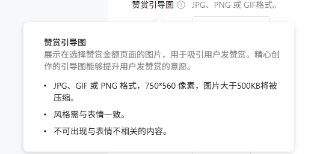
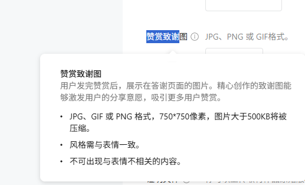

# 微信表情赞赏图片设计标准｜赞赏引导图与赞赏致谢图

> 版本：**v1.0**  
> 整理日期：**2026-11-19**（不代表微信平台规则发布日期）  
> 依据：用户提供的**两张微信表情开放平台上传界面截图**。截图作为原始依据一并入库。  
> 适用于本仓库全部表情系列，包括 **盘串猫、手把件、圣诞节、工位喵、小猪咪** 等。  
> **注意**：微信表情开放平台可能更新规则；正式投稿时请再次以当前上传页面提示为准。

## 1. 平台原始截图

### 1.1 赞赏引导图



截图说明：在用户赞赏前显示于赞赏金额页面，用于吸引用户赞赏；有吸引力、精心创作的引导图可以提升赞赏意愿。

### 1.2 赞赏致谢图



截图说明：在用户发完赞赏后展示于答谢页面，用于表达感谢；精心创作的致谢图有助于激发用户分享意愿，吸引更多用户赞赏。

## 2. 图片规格与平台截图原文要求

| 素材 | 用途 | 精确尺寸 | 支持格式 | 平台截图的文件大小说明 | 视觉与内容要求 |
|---|---|---:|---|---|---|
| **赞赏引导图** | 用户赞赏前的赞赏金额页面 | **750 × 560 px** | **JPG、GIF 或 PNG** | **图片大于 500 KB 将被压缩** | 风格需与表情一致；不可出现与表情不相关的内容 |
| **赞赏致谢图** | 用户完成赞赏后的答谢页面 | **750 × 750 px** | **JPG、GIF 或 PNG** | **图片大于 500 KB 将被压缩** | 风格需与表情一致；不可出现与表情不相关的内容 |

**准确解释：**

- 截图中给出的句式是**“图片大于500KB将被压缩”**，这是**压缩阈值提示**，不应擅自转述成“超过500KB拒绝上传”。
- 截图**没有规定两张赞赏图片必须为透明背景或不透明背景**，也没有明确规定“必须无文字”。不要将横幅“不能有文字”、封面/图标“必须透明”的规则强加给赞赏图片。
- 截图**未提供 GIF 动画的帧数、时长和循环限制**；如制作 GIF，应另行核对提交界面或相应规则。
- 以上是**本次已获得的界面截图明确支持的内容**。下面的颜色、文字和构图等要求是本仓库自己的设计建议，不冒充平台强制标准。

## 3. 赞赏引导图｜750 × 560

**目的**：吸引用户对这一套表情进行自愿赞赏，让用户感受到角色的魅力与创作心意。

### 3.1 必须满足的截图要求

1. 最终文件为**750×560像素**，JPG、GIF或PNG格式。
2. **风格与对应表情保持一致**：角色、脸型、耳朵、描边、颜色和主题道具不能随意变样。
3. **内容与对应表情有关**，不能引入无关人物、商品或场景。
4. 图片**大于500KB将被压缩**；提交前应做好清晰度和大小检查。

### 3.2 本仓库设计建议（非截图硬性要求）

- 以主角为视觉中心，让猫咪用**递礼物、挥手、抱文玩、期待表情**等动作传达友好邀请；保留原角色标志性外貌。
- 可以添加简短、自然、不过度施压的邀请文案，例如「喜欢的话支持一下～」「感谢你的喜欢！」。这属于项目创作建议；**不是微信要求必须添加文字**。
- 避免夸大、强迫性表述，例如“不给赞赏就不能使用表情”；不虚构平台认证或赞赏回报。
- 美术上可使用与主题相符的浅暖色、礼物、爱心、珠串、雪花等，但不应堆满背景造成主体被遮挡。
- 如使用白色或浅色背景，应确保角色深棕轮廓清晰；选用 PNG 时根据实际设计决定是否使用 Alpha，**不预设平台强制透明**。

## 4. 赞赏致谢图｜750 × 750

**目的**：向已完成赞赏的用户表示感谢，传达温暖的反馈，适合在赞赏后的答谢页面独立展示。

### 4.1 必须满足的截图要求

1. 最终文件为**750×750像素**，JPG、GIF或PNG格式。
2. **风格与对应表情保持一致**，角色不能被替换成不同画风。
3. **内容与对应表情有关**，重点应围绕感谢和主题角色。
4. 图片**大于500KB将被压缩**，上传前检查大小及压缩后的文字、脸部清晰度。

### 4.2 本仓库设计建议（非截图硬性要求）

- 主角可以做**鞠躬、双爪比心、抱星星、举起礼物、开心挥手**等感谢动作，与引导图形成明显区别。
- 允许使用简短致谢文字，如「谢谢你的赞赏！」「有你真好！」；**这是可选的创作建议，不是平台明确强制要求**。
- 画面突出感激与快乐，动作比引导图更温暖、满足；避免再用相同的邀请付款内容，造成用途混淆。
- 可以增加少量和专辑主题相符的点缀，色系与引导图互相呼应；不复制同一幅图仅更换尺寸和一句话。

## 5. 各系列角色一致性要求（项目内部）

| 系列 | 角色与代表元素 | 推荐的引导情节 | 推荐的致谢情节 |
|---|---|---|---|
| **手把件／万物皆可盘** | 粉色无毛猫、巧克力棕粗描边、文玩核桃／紫檀珠串／葫芦等 | 猫咪举起文玩、友好展示收藏 | 猫咪抱着葫芦或手串开心感谢 |
| **盘串猫·圣诞节** | 同一只粉色无毛猫、圣诞帽、礼物、红绿金配色 | 圣诞礼物与铃铛、温馨邀请 | 抱星星或礼物、雪花与祝福 |
| **工位喵** | 同一只粉色无毛猫、电脑／工牌／文件等 | 打工猫举起小牌子或咖啡邀请 | 下班轻松笑脸、感谢支持 |
| **小猪咪** | 粉色小猪、软耳朵、猪鼻、小卷尾；**不戴文玩珠串** | 抱着好吃的、期待分享 | 开心捧甜点或挥爪感谢 |

每一套使用**自己**的形象与配件，不把圣诞元素无故放进普通文玩系列，也不能给小猪咪添加文玩项链或手串。

## 6. 文件格式、工程导出和命名建议

本章是**项目内部交付要求**，并非截图规定的所有技术细则。

| 文件 | 建议命名 | 目标尺寸 | 内部建议大小 | 备注 |
|---|---|---:|---|---|
| 赞赏引导图 | `赞赏引导图_750x560.jpg`、`.png` 或 `.gif` | **750×560** | **≤400 KiB**，尽量少触发平台二次压缩 | JPG推荐sRGB、RGB不透明；PNG/GIF视设计需要 |
| 赞赏致谢图 | `赞赏致谢图_750x750.jpg`、`.png` 或 `.gif` | **750×750** | **≤400 KiB**，尽量少触发平台二次压缩 | PNG清晰但有时较大，可使用优化后的JPG |
| 高清设计母版 | `source_赞赏引导图.png` 等 | 建议至少1500px宽 | 不限 | 保存高清、可编辑版本，不直接投稿 |

- 请使用**真实的 JPG／PNG／GIF 编码**，不能仅修改文件后缀。
- 不许通过横向拉伸、竖向压扁角色来凑尺寸；保持等比缩放或重新排版。
- 建议在 750px 原始尺寸和微信页面模拟尺寸都检查一遍：文字准确，五官、道具完整，边缘没有毛刺。
- 如采用动图，检查每帧画面连续且用途明确，循环/帧数限制以届时平台规则为准。
- 上传前优先考虑清晰度；如果文件超过内部400 KiB建议目标，应优化，但**不要把内部目标解释成平台禁止上传**。

### 6.1 推荐目录结构

```text
系列名/
└── album_assets/
    ├── 横幅_750x400.jpg
    ├── 封面_240x240.png
    ├── 图标_50x50.png
    ├── 赞赏引导图_750x560.jpg
    └── 赞赏致谢图_750x750.jpg
```

每个系列应保留自己的引导图和致谢图，不要直接在不同角色/主题之间混用。

## 7. 投稿前验收清单

- [ ] **引导图 750×560，致谢图 750×750**，尺寸完全正确。
- [ ] 扩展名与**真实图片格式**一致，格式为 JPG／PNG／GIF 之一。
- [ ] 文件大小记录清楚；超过500KB时了解平台**会压缩**，而非擅自认定拒收。
- [ ] 两张图属于当前专辑，同一角色、同一画风、相应主题道具。
- [ ] 引导图体现友好邀请；致谢图体现感谢；两张图不是仅简单改字或强行拉伸。
- [ ] 如果有文字，字形、错别字、排版已经检查，50%缩小预览仍清晰。
- [ ] 背景方式是**依据具体设计选择的**，不把横幅/封面/图标的背景规则套到赞赏图。
- [ ] 没有无关商品、二维码、联系方式、误导性承诺、水印或影响观感的装饰。
- [ ] 图片通过肉眼检查，角色没有畸形、异色、边缘脏点或不完整四肢。
- [ ] 最终以**微信表情开放平台当次上传页面的要求和反馈**为准。

## 8. 与全仓库规范的关系

- 三项其他专辑素材（**横幅、封面、聊天图标**）：[微信表情专辑图片设计标准](微信表情专辑图片设计标准.md)。
- 角色、字体、色票、表情主图与完整验收：[根目录STYLE_GUIDE.md](../STYLE_GUIDE.md)。
- 这两份专项图片标准**一起适用**，但不能互相替换平台条款；具体上传字段各守各的截图要求。

## 版本记录

| 版本 | 日期 | 说明 |
|---|---|---|
| **v1.0** | **2026-11-19** | 根据用户提供的两张平台原始截图整理赞赏引导／致谢图尺寸、格式、压缩提示、视觉要求，补充内部设计与交付验收规则 |
