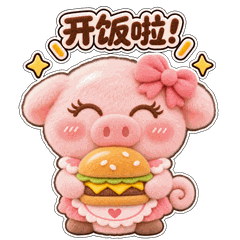

# 🐷 小猪咪｜角色设定与表情包项目

> **小猪咪：世界这么大，先吃一口再说！**
>
> 与「盘串喵」同一世界观、暖色系调性的 **CP 角色**。盘串喵爱盘文玩，小猪咪最爱吃好吃的；两只角色造型和材质风格各有区别。

**当前阶段：毛绒角色视觉规范 v2.0（2026-11-21）＋首张表情 v2.0 已上传**  
本目录现已收录首张「开饭啦！」毛绒玩偶风透明表情，**v2.0 是后续所有小猪咪表情的唯一现行视觉母版**；此前 v1.0 保留作历史稿。所有作品均尚未提交或通过微信平台审核。

## 1. 角色基本信息

| 项目 | 定义 |
|---|---|
| 正式名称 | **小猪咪** |
| 角色原型 | 可爱的小粉猪，Q版、圆润、拟人化表情 |
| 角色关系 | **盘串喵的 CP**，可单独使用，也可以与盘串喵组成情侣/搭档双人表情 |
| 核心爱好 | **寻找、品尝、享受各种好吃的** |
| 性格关键词 | 开朗、爱撒娇、嘴馋、治愈、容易被美食收买；偶尔护食、傲娇、犯困 |
| 代表情绪 | 吃到好吃的幸福感、对甜品两眼放光、等开饭、想吃、护食、吃饱、满足、分享 |
| 主要形象 | **暖粉色细密短绒毛绒母猪，圆脑袋、短软下垂大耳朵、椭圆双孔猪鼻、肉嘟嘟脸颊、睫毛、短圆四肢和小卷尾** |
| 常见姿态 | 抱着汉堡坐着、捧蛋糕期待、抱包子大口吃、喝奶茶、摸肚子、递食物 |
| 默认女性识别与禁止项 | **粉色蝴蝶结、粉白心形小围裙、微翘睫毛**；没有手串、项链、珠链或文玩饰品；不把核桃、菩提当成默认道具 |

> **绝对优先规则：小猪咪的主题是“吃”，不是“盘”。** 之前曾出现的带红棕色珠串的粉猪图稿属于被淘汰的早期概念，不能作为之后的视觉基准。参考形象应是后来确认的**抱汉堡、吃蛋糕／包子、没有手串**的版本。

## 2. 与盘串喵的关系

| 角色 | 小猪咪 🐷 | 盘串喵 🐱 |
|---|---|---|
| 一眼识别 | 小猪鼻、软耳朵、卷尾、圆肚皮 | 大三角耳、无毛猫褶纹、拽拽半眯眼 |
| 人设 | 美食至上，情绪更外露、软萌 | 文玩至上，傲娇、嘴硬、淡定 |
| 主要道具 | 食物、叉勺、小盘子、饮料杯 | 手串、核桃和其他文玩 |
| CP 趣味 | “先吃饭！”“再来一口！” | “先盘两下。”“别碰我的串。” |
| 视觉关联 | 暖粉色调、可爱Q版比例、深色描边与金黄提示符号；**小猪咪采用独立的短绒毛绒玩偶质感和白色外描边** | 保持盘串喵既有角色特征 |

**互动原则：** 可以画一起吃饭、分食、争最后一口、投喂、约会、互相嫌弃又互相照顾；不要把小猪咪变成盘串喵的换皮版本，不强行给小猪咪加手串。双人画面同时保证两个角色的五官和耳朵有明确差异。

## 3. 视觉基准（摘要）

- **形体**：圆头大脸、两只下垂或微外翻的软耳朵、粉色椭圆猪鼻和两个清晰鼻孔、红润脸颊、肉嘟嘟的短圆四肢、小卷尾。
- **主视觉**：幸福眯眼、惊喜星星眼、吃东西时的张嘴笑、嘴馋流口水、满足摸肚皮。情绪变化很大，但始终是同一只小猪。
- **常用食物**：汉堡、包子、水饺、草莓蛋糕、奶茶、甜甜圈、面条、冰淇淋、炸鸡、火锅等。**每张只突出一种食物或一种明确用餐情境**。
- **现行画风（v2.0）**：参考本目录的[高清毛绒母版](source/01_开饭啦_毛绒视觉基准_v2.0_1254.png)，呈现软萌日系微缩布偶、细密短绒、暖色漫射光、低饱和桃粉、轻微颗粒；**黑/极深棕粗主描边＋更窄的白色外描边**，文字同规格，拒绝光滑平涂、硬塑3D或黑金风。
- **默认女性外观**：粉色蝴蝶结与白粉色心形小围裙，开心弯眼或黑豆眼并带柔和睫毛；可依剧情调整姿态、表情与道具，但不可随意换掉角色设计；任何服装都不能遮住猪鼻和软耳朵。禁止手串、项链等文玩/珠串。
- **文字**：深棕色粗圆手写感中文，外侧黑色粗主描边和更窄白色外描边；2–6字优先，文字不遮住鼻子、嘴或食物。

具体的尺寸、颜色、字体字号、透明背景、生成要求和验收规则请看 **[小猪咪完整制作规范](STYLE_GUIDE.md)**。

## 4. 微信表情专辑的推荐导出规格

> 以下数字是本项目的**内部制作目标**，不是微信表情开放平台对所有投稿类型的实时官方要求；正式投稿时以对应入口的提示为准。

| 素材 | 推荐尺寸 | 格式 | 项目目标 | 背景 |
|---|---|---|---|---|
| 静态主表情 | 240×240 px | PNG | ≤100 KiB，优选≤80 KiB | **透明**；如需纯白版另存 |
| 动态表情 | 240×240 px | GIF | 尽量≤100 KiB | 透明、循环 |
| 缩略图 | 120×120 px | PNG | ≤50 KiB | 透明 |
| 专辑封面 | 240×240 px | PNG | ≤80 KiB | **透明** |
| 聊天面板图标 | 50×50 px | PNG | ≤30 KiB | **透明**、不带文字 |
| 详情页横幅 | 750×400 px | JPG/PNG | 优选≤80 KiB | **不透明**、投稿版无文字 |
| 高清母版 | 推荐1024×1024 px | PNG/分层源文件 | 不限 | 优先保留透明及可编辑性 |

**关于纯白背景：** 此前盘串喵系列有专门导出的「纯白背景版」，小猪咪也可以制作相同的展示版本，底色固定为 RGB `#FFFFFF` 且不透明；但**白底版和透明投稿版必须分文件夹保存**，不能把白底文件误认为透明文件。

## 5. 后续创作方向（提案，非已定稿）

第一套可以围绕「小猪咪·好吃的都归我」制作 16 张微信聊天表情；例如“开饭啦！／好香啊！／再来一口／是我的！／给你一口／真好吃！／撑到了／等外卖／奶茶续命／偷偷吃／不许抢／我要吃肉／饿扁了／饭搭子呢／幸福晕了／晚安饱饱”。

除首张「开饭啦！」v2.0 已确认并上传外，其余是**文案选题建议**，不代表已经完成或最终确认的 16 张正式文件；后续创作仍需逐张确定动作与食物。

## 6. 推荐文件组织

```text
小猪咪/
├── readme.md             # 角色基础信息（本文；沿用原目录文件名）
├── STYLE_GUIDE.md        # 详细制作标准及验收规范
├── source/               # 已保存1254px高清毛绒视觉母版
├── stickers_240/         # 已保存240×240透明PNG：v1.0存档＋v2.0现行
├── white_background/     # 如需展示，单独保存纯白版
├── album_assets/         # 后续保存横幅、封面、图标
└── previews/             # 后续保存拼图、审稿与透明度预览
```

实际已经建立 `source/` 和 `stickers_240/` 两个图片目录；其余未出现的目录仍为后续建议。

## 7. 共用规范与版本

- 跨角色共用的投稿尺寸、流程和质量检查请参阅仓库根目录的 **[统一表情包制作规范](../STYLE_GUIDE.md)**。
- **差异发生冲突时，以本目录现行 `STYLE_GUIDE.md` v2.0 与高清毛绒母版优先**：小猪咪不戴文玩手串、保留女性外观，以美食为核心道具。
- v1.0（2026-11-19）：初始平涂版本的设定，保留存档。
- **v2.0（2026-11-21，现行）**：以《开饭啦！》毛绒版为正式角色母版，确定柔软短绒材质、女性识别元素及双层黑白描边。

## 8. 已收录图稿

| 编号 | 名称 | 版本 | 文件 | 状态 |
|---|---|---|---|---|
| 01 | 开饭啦！ | **v2.0（2026-11-21，现行）** | [240×240 透明 PNG](stickers_240/01_开饭啦_v2.0.png) · [1254px 高清母版](source/01_开饭啦_毛绒视觉基准_v2.0_1254.png) | **以后设计的标准参考**；未经过微信审核 |
| 01 | 开饭啦！ | v1.0（2026-11-20） | [旧版透明 PNG](stickers_240/01_开饭啦_v1.0.png) | 历史试制稿；不作为后续视觉基准 |

**现行 v2.0 视觉特征**：小粉猪变为细密短绒的软萌布偶质感，保留母猪形象、软猪耳、双鼻孔、睫毛、粉色蝴蝶结、粉白心形围裙和卷尾；汉堡为第01张的主题道具。角色与深棕色文字统一采用黑/深棕粗主描边＋更窄白外描边。**背景真实透明**，现有240px RGBA稿及1254px高清母版均已上传。后续所有表情应使用 v2.0 而非 v1.0 作为视觉参照。


