# 盘串猫 · V2 参考画风表情包

基于粉色无毛猫（夸张大耳朵、拽眼神、深色粗轮廓、红棕色手串）制作的 **16 张单独表情图片**。

- `240/`：16 张 240×240 透明 PNG，微信表情主要素材
- `120/`：16 张 120×120 透明 PNG，缩略图
- `512/`：16 张 512×512 透明 PNG，高清备份
- `preview/`：表情合集总览和深色背景透明度检查

> 当前为视觉概念和素材预检版本。正式上传微信表情开放平台前，请按平台实时规格和内容规范再次检查。

## 总览

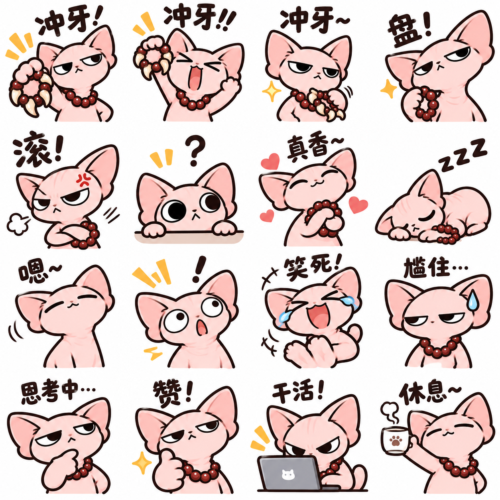

## 每张表情

| | | | |
|---|---|---|---|
| 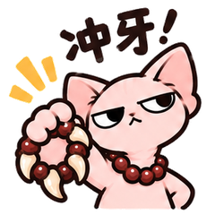 | 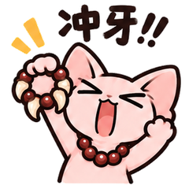 | 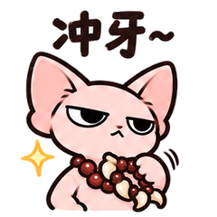 | 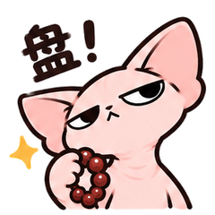 |
| 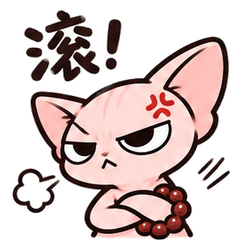 | 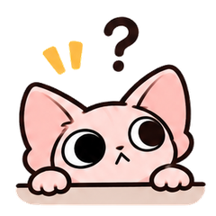 | 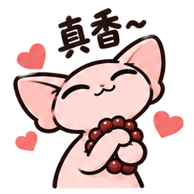 | 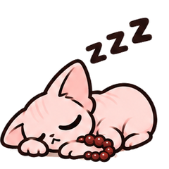 |
| 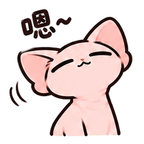 | 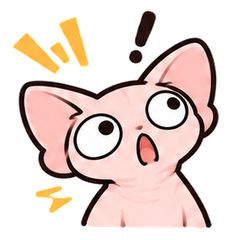 | 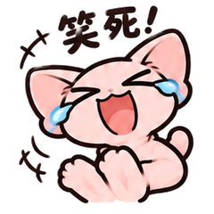 | 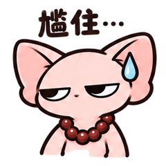 |
| 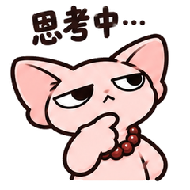 | 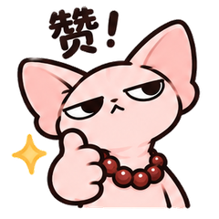 | 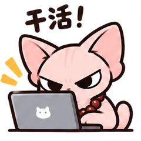 | 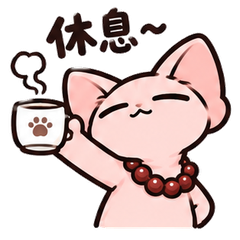 |

## 16 个文件名

01. `01_冲牙.png`
02. `02_冲牙加油.png`
03. `03_冲牙得意.png`
04. `04_盘起来.png`
05. `05_滚.png`
06. `06_好奇.png`
07. `07_真香.png`
08. `08_睡觉.png`
09. `09_嗯.png`
10. `10_惊讶.png`
11. `11_笑死.png`
12. `12_尬住.png`
13. `13_思考中.png`
14. `14_赞.png`
15. `15_干活.png`
16. `16_休息.png`
